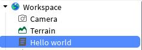
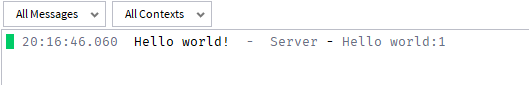

<style>
  details {
    margin-bottom: 7px  ;
    border: lightgrey 1px solid;
    padding: 8px
  }
  summary {
    font-size: 20px
  }
  img {
    width: auto;
    height: auto;
  }

  code {
    background: #eeeeeeff 2px;
    padding: 2px 2px 2px 2px;
    border-radius: 6px
  }

  body {
    background: #ffffffff;
    color: #000000ff;
  }

  h1 {
    font-weight: bold;
    text-decoration: underline;
  }

  h2 {
    font-weight: bold;
    text-decoration: underline;
  }

  h3 {
    font-weight: bold;
    text-decoration: underline;
  }
  
  /* Zielvorgabe für alle Blockquotes */
  blockquote {
    border-left: 5px solid #7cb459ff; /* Ein farbiger Strich links */
    padding-left: 20px;             /* Abstand zum Text */
    background-color: #edfbeaff;      /* Ein leichter Hintergrund */
    margin-left: 10px;              /* Die eigentliche Einrückung */
    color: #333;                    /* Textfarbe */
  }

  /* Optional: Wenn du das Aussehen der Liste im Blockquote verändern willst */
  blockquote ul {
    list-style-type: square;
  }


  ul li, ol li {
    margin-top: 20px; /* Gewünschten Abstand hier anpassen */
  }

  .a1 {
    font-weight: bold;
    text-decoration: underline;
  }

  .mermaid {
    background: white;
    padding: 30px;
    border-radius: 8px;
    box-shadow: 0 4px 6px rgba(0,0,0,0.05);
  }

  .code-verlauf-text {
    font-family: "Courier New";
    font-weight: bold;
    /* Verlauf definieren und Hintergrund vergrößern */
    background: linear-gradient(90deg, #f1d8a2, #e4a41b, #8d600d, #ac7d1a, #e4a41b, #cea54e, #f1d8a2);
    background-size: 200% auto;
    
    /* Farbverlauf auf den Text beschränken */
    color: transparent;
    -webkit-background-clip: text;
    background-clip: text;
    
    /* Animation zuweisen */
    animation: verlaufAnimieren 4s linear infinite;
  }

  /* Keyframes für die Bewegung von links nach rechts */
  @keyframes verlaufAnimieren {
    to {
      background-position: 200% center;
    }
  }

</style>

# Skript

## Print
* wenn ich einf. in `workspace` einen **Script** hinzufüge & dann `Play` drücke, dann wird d. Code ausgeführt & ausgeggeben 

```luau
print("Hello World")
```


<span class="a1">Ausgabe<span>:


* wenn man auf`Hello world:1` drauf klickt, dann geht man zu dem Script, wo man es geschrieben hat !

# Variables

## Local

* `local` sorgt dafür, dass eine `Var.` nur in diesem einen Skript funktioniert & $\lnot$ global ist !

# Properties

## Wie nimmt man ein GEwissen objekt im Explorer ?

`game.Workspace.Baseplate.Transparency = 0`
* Man geht mit .Ort d. Hierarchie durch. um im Skirpt auf das Objekt zuzugreifen
* Wir haben somit d. Baseplatte d. Eigenschaft geg., dass d. Trasparincy = 1 ist 

# Functions

```luau
local myBaseplate = game.Workspace.Baseplate

local function changeTansparency()
	myBaseplate.Transparency = 1
	
end

-- Wir müssen d. Funktion auch Aufrufen
changeTansparency()
```

# Scrips

## Local Scripts

### ServerClientModel

<span class="a1">Player</span>
* Das ist d. was d. Spieler sehen können

<span class="a1">Client(= verbunden mit Server)</span>
* d. ist d. POV d. einzelnen Spieler
    * wenn ich zum Beispiel etw. nur f. eine Person ändern möchte, dann benutze ich `LocalScripts`, weil es nur f. diese eine Person gelten soll & $\lnot$ f. d. anderen Spieler.
        * Wenn ich einen Event mache $\implies$ `Script`
        * wenn ich zum Beispiel den Inventar f. eine Person programmieren möchte $\implies$ `LocalScript`
            * wenn VIP gekauft

### :WaitForChild(<Objektname>)
*  sucht n. einem Objekt mit dem Objektnamen

Wann umuss verw. werden ?
* Spieler laden d. Spielwelt ü. Internet herunter.
    * obj. im `Workspace`, in d. `ReplicatedStorage` oder in d. `PlayerGui` brauchen oft einige Millisekunden zum Laden.
    * Wenn  `LocalScript` startet $\to$ Obj fehlen noch

```luau
local part = game.Workspace:WaitForChild("Part")

part.Touched:Connect(function()
	part.BrickColor = BrickColor.random()
end)
```
<video controls src="20260810-1958-00.7059394.mp4" title="Title"></video>

* D. Farbe ändert sich f. den Spieler, aber im Client Mode bleibt es immer unverändert


<details style="background: #f0f0f0">
<summary ><u><b>Wie kann ich meine eigene modifizierte Hotbar in erstellen ?</b></u></summary>
  
  ### Ort d. Speicherung:
  * game.StarterGui.HotbarGui.HotbarHandler


  ### Was wird benötigt ?
  * den `aktuellen Spieler` damit wir im Spiel auf seinen `Rucksack` zugreifen können, um d. Karten zu ermitteln & darzustellen: <code class="code-verlauf-text">game: getService("Players")</code>
  * wir benötigend d. Informationen d. Karten(`CardsData`), damit wir di. Hintergründe, Charaktere, Rahmen, usw. darstellen können: <code class="code-verlauf-text">require(ReplicatedStorage:WaitForChild("CardsData"))</code>
  * Die `ScreenGui` die die Modifikationen auf dem Fenster des Spielers darstellen kann: <code class="code-verlauf-text">script:FindFirstAncestorWhichIsA("ScreenGui") or script.Parent</code>
    * Wenn wir zum Beispiel eine verschachtelte Gui haben & wir mehrere Ebenen haben, können wir mit `FinfFirstAncestorWhichIsA("<type>")` direkt die Mutterklasse finden, das dem gescuhten Typen enspricht. Es wandert also automatisch bereits die einzelnen Ebenen durch !

  ### Wir müssen die Hotbar von Roblox ausschalten:
  <pre style="background: #181818"><code class="code-verlauf-text">pcall(function()
	StarterGui:SetCoreGuiEnabled(Enum.CoreGuiType.Backpack, false)
end</code></pre>
>* pcall = protected call
>   * Sorgt dafür, dass das `Skript` nicht abstürzt, wenn die ``Hotbar`` noch nicht geladen ist
* Frame erstellen, indem dann die einzelnen Felder mit den Bildern und den ensprechenden Rahmen erstellt wird.
<pre style="background: #181818"><code class="code-verlauf-text">local hotbarFrame = hotbarGui:FindFirstChild("HotbarFrame")
if not hotbarFrame then
	hotbarFrame = Instance.new("Frame")
	hotbarFrame.Name = "HotbarFrame"
	hotbarFrame.Size = UDim2.new(0, 560, 0, 70)
	hotbarFrame.Position = UDim2.new(0.5, 0, 1, -45)
	hotbarFrame.AnchorPoint = Vector2.new(0.5, 1)
	hotbarFrame.BackgroundTransparency = 1
	hotbarFrame.ZIndex = 5
	hotbarFrame.Parent = hotbarGui
end</code></pre>
* Ein `UIListLayout`, damit die Felder automatisch nebeneinander platziert werden
<pre style="background: #181818"><code class="code-verlauf-text">local listLayout = hotbarFrame:FindFirstChildWhichIsA("UIListLayout")
if not listLayout then
	listLayout = Instance.new("UIListLayout")
	listLayout.FillDirection = Enum.FillDirection.Horizontal
	listLayout.HorizontalAlignment = Enum.HorizontalAlignment.Center
	listLayout.VerticalAlignment = Enum.VerticalAlignment.Center
	listLayout.Padding = UDim.new(0, 6)
	listLayout.Parent = hotbarFrame
end</code></pre>

* Die Informationen der einzelnen Fabrn, um einfach die Rahmen einzufärben und den GRadienten zu erstellen

<pre style="background: #181818"><code class="code-verlauf-text">local RARITY_COLORS = {
	["Basic"] = Color3.fromRGB(160, 160, 160),
	["Uncommon"] = Color3.fromRGB(85, 255, 127),
	["Rare"] = Color3.fromRGB(60, 150, 255),
	["Epic"] = Color3.fromRGB(170, 0, 255),
	["Legendary"] = Color3.fromRGB(255, 215, 0),
	["Mythic"] = Color3.fromRGB(255, 40, 40),
	["SpecialEdition"] = Color3.fromRGB(68, 236, 237)
}

local VARIANT_GRADIENTS = {
	["Holographic"] = ColorSequence.new({
		ColorSequenceKeypoint.new(0.0, Color3.fromRGB(255, 60, 60)),
		ColorSequenceKeypoint.new(0.2, Color3.fromRGB(255, 200, 40)),
		ColorSequenceKeypoint.new(0.4, Color3.fromRGB(60, 255, 100)),
		ColorSequenceKeypoint.new(0.6, Color3.fromRGB(40, 200, 255)),
		ColorSequenceKeypoint.new(0.8, Color3.fromRGB(180, 70, 255)),
		ColorSequenceKeypoint.new(1.0, Color3.fromRGB(255, 60, 60))
	}),
	["Crystal"] = ColorSequence.new({
		ColorSequenceKeypoint.new(0.0, Color3.fromRGB(20, 60, 160)),
		ColorSequenceKeypoint.new(0.35, Color3.fromRGB(100, 200, 255)),
		ColorSequenceKeypoint.new(0.5, Color3.fromRGB(255, 255, 255)),
		ColorSequenceKeypoint.new(0.65, Color3.fromRGB(100, 200, 255)),
		ColorSequenceKeypoint.new(1.0, Color3.fromRGB(20, 60, 160))
	}),
	["Galaxy"] = ColorSequence.new({
		ColorSequenceKeypoint.new(0.0, Color3.fromRGB(30, 80, 255)),
		ColorSequenceKeypoint.new(0.3, Color3.fromRGB(170, 30, 255)),
		ColorSequenceKeypoint.new(0.65, Color3.fromRGB(255, 70, 190)),
		ColorSequenceKeypoint.new(0.85, Color3.fromRGB(255, 230, 80)),
		ColorSequenceKeypoint.new(1.0, Color3.fromRGB(30, 80, 255))
	})
}</code></pre>

* 2 Tabellen. Der eine speichert die aktuellen Karten, die im Rucksack und somit in der Hotbar sind und die andere managed die Rahmen und die Farbverläufe
* <code class="code-verlauf-text">local activeGradients = {}</code>
  * speichert Verweise auf aktive Farbverläufe (UIGradient) oder visuelle Effekte, die gerade auf den Karten in der Hotbar laufen.

  * **Wofür man es braucht**: Wenn sich die Hotbar aktualisiert (weil du z. B. eine neue Karte einsammelst oder das Inventar wechselt), läuft das Skript oft in einer Schleife und baut Teile der Anzeige neu auf. Damit das Spiel nicht jedes Mal vergisst, welche Effekte oder Animationen gerade auf den Karten liefen (oder um alte Effekte gezielt zu löschen, bevor neue erstellt werden), werden sie in dieser Tabelle zwischengespeichert.
*  <code class="code-verlauf-text">local createdSlots = {}</code>
  * Es speichert eine Liste der bereits erzeugten Hotbar-Slots (also die 9 visuellen Kacheln/Felder auf dem Bildschirm).

  * **Wofür man es braucht**: Das Skript prüft hiermit, ob die 9 Slots für die Hotbar bereits existieren. Wenn der Spieler z. B. stirbt, das GUI neu lädt oder das Skript aktualisiert wird, verhindert diese Tabelle, dass das Spiel versehentlich doppelte Slots übereinander zeichnet. Das Skript sieht nach: "Ah, Slot 1 bis 9 wurden bereits erstellt" und muss sie nicht jedes Mal komplett neu initialisieren, sondern kann bestehende einfach wiederverwenden oder aktualisieren. 
</details>


<script>
  window.MathJax = {
    tex: {
      inlineMath: [['$', '$'], ['\\(', '\\)']]
    }
  };
</script>
<script type="text/javascript" async
  src="https://cdn.jsdelivr.net/npm/mathjax@3/es5/tex-mml-chtml.js">
</script>
