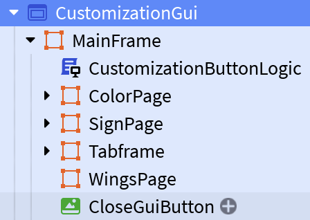
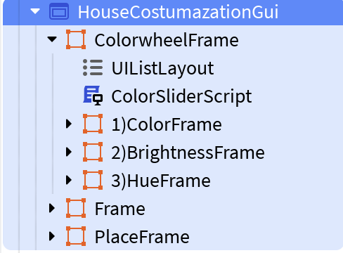

# Syntax

<u><b>Syntax</b></u>

* `t = math.clamp(t, 0, 1)`:
  * $\lt 0 \implies t = 0$
  * $=0 \implies t = [0,1]$
  * $\gt \implies t = 1$

# House Stylization

## Open StylizationGui with the machine

* `CustomazationGui` = <code style="color: #37aa28ff">game.StarterGui.CustomizationGui</code>(<code style="color: #00b3ffff">SurfaceGui</code>)
  * 
* `HouseCustomazationGui` = <code style="color: #37aa28ff">game.StarterGui.HouseCostumazationGui</code>(<code style="color: #00b3ffff">SurfaceGui</code>)
  * 
* **Server-Skript (Sign-Aktualisierung & Haus-Logik):**
  `ChangeSignManager` = <code style="color: #37aa28ff">game.ServerScriptService.CustomizeHouse</code> 

* **Local-Skript (GUI-Tabs & Schließen-Button):**
<code style="color: #37aa28ff">game.StarterGui.CustomizationGui.MainFrame.CustomizationButtonLogic</code>

* **Das Namensschild im Haus:**
<code style="color: #37aa28ff">game.Workspace.Houses.[HausName].Ebene1.NamensSchild.NameDisplay.PlayerName</code>

* **Das UI selbst:**
<code style="color: #37aa28ff">game.StarterGui.CustomizationGui</code>

# Roblox Tycoon: Sign Customization & GUI Fix

1) CustomizationButtonLogic
2) SignTextChangingLogic(LocalScript) $\to$ CustomizationEvent(RemoteEvent) $\to$ ChangeSignManager(Server-Skript)

## CustomizationButtonLogic

* **Pfad**:
  * <code style="color: #37aa28ff">game.StarterGui.CustomizationGui.MainFrame.CustomizationButtonLogic</code>

* **Logik**:
  * Steuert den CostumizationGui
    * Tabwechsel
    * schließt d. Gui(`CloseGuiButton`)

## ChangeSignManager(Server-Skript)
* **Pfad**:
  * <code style="color: #37aa28ff">game.ServerScriptService.ChangeSignManager</code>

* **Logik**:
  * hier wird d. Nachricht v. Client aufgenommen(`CustomizationEvent`: <code style="color: #37aa28ff">game.ReplicatedStorage.CustomizationEvent</code>)
  * iteriert durch jedes haus bis d. Haus mit dem SpielerID gefunden wurde $\implies$ Ändert das entsprechende Schild in diesem Haus

## SignTextChangingLogic
<code style="color: #37aa28ff">game.StarterGui.CustomizationGui.MainFrame.SignPage.TextBox.SignTextChangingLogic</code>

* Dieser empfängt den RemoteEvent ()

<pre>
👤 [ Spieler ]
    │
    ▼ (Klickt auf ProximityPrompt / Öffnet Menü)
🖥️ [ StarterGui.CustomizationGui ]
    │
    ├── 📄 [ CustomizationButtonLogic ] (LocalScript)
    │     ├── Steuert die Reiter (Farben, Schilder, Flügel)
    │     └── Sendet Signale oder triggert Funktionen
    │
    ▼ (Spieler tippt Emoji ein / ändert Text)
📡 [ RemoteFunction / RemoteEvent ] ("CustomizeHouse" / "updateSign")
    │
    ▼ (Server verarbeitet das Signal sicher)
⚙️ [ ServerScriptService ] (Zentraler Manager)
    ├── Prüft: Welches Haus gehört dem Spieler? (`getPlayerHouse`)
    └── Findet das Zielobjekt im Workspace:
          │
          ▼
🏠 [ Workspace.Houses.HouseX ]
    └── Ebene1 ➔ NamensSchild ➔ NameDisplay ➔ 🪧 [ PlayerName ] (TextLabels)
</pre>

# 🛠️ Roblox Tycoon: Anpassungssystem (Customization)

## 📁 1. Relevante Pfade
* 🖥️ **GUI (Client):** `game.StarterGui.CustomizationGui`
* 📡 **Netzwerk-Events:** 
  * `game.ReplicatedStorage.CustomizationEvent` (für Textänderungen)
  * `game.ReplicatedStorage.ToggleCustomizationGui` (für das Öffnen/Schließen)
* ⚙️ **Server-Skripte:**
  * `game.ServerScriptService.ChangeSignManager`
  * `game.Workspace.Houses.[HouseName].Ebene1.CustomizationMachine.ProximityPrompt.CostumazationGuiHandler`
* 🪧 **Zielobjekt im Workspace:** `game.Workspace.Houses.[HouseName].Ebene1.NamensSchild.NameDisplay.PlayerName`

---

## 🔗 2. Verbindungen und Datenfluss

### Menü öffnen:
👤 Spieler klickt $\to$ 🖱️ `ProximityPrompt` $\to$ ⚙️ `CostumazationGuiHandler` (Server) $\to$ 📡 `ToggleCustomizationGui` (`FireClient`) $\to$ 🖥️ `CustomizationButtonLogic` (Client öffnet GUI)

### Text/Emoji ändern:
⌨️ `TextBox` Eingabe $\to$ 📄 `SignTextChangingLogic` (Client) $\to$ 📡 `CustomizationEvent` (`FireServer`) $\to$ ⚙️ `ChangeSignManager` (Server aktualisiert Workspace)

---

## 📄 3. Erklärung der einzelnen Komponenten

* 📄 **`CostumazationGuiHandler`** (Server-Skript im ProximityPrompt): Fängt den Klick an der Maschine ab und signalisiert dem Client per `RemoteEvent`, dass das Menü geöffnet werden soll.
* 📄 **`CustomizationButtonLogic`** (LocalScript im MainFrame): Verwaltet die UI-Navigation (Wechseln zwischen den Reiter-Seiten wie Farben, Schilder, Flügel) und schließt das Menü über den Schließen-Button. Lauscht zudem auf das Öffnungs-Signal vom Server.
* 📄 **`SignTextChangingLogic`** (LocalScript in der TextBox): Überwacht die Texteingabe des Spielers, begrenzt die Länge auf ein Zeichen (für Emojis) und sendet den neuen Inhalt an den Server.
* 📄 **`ChangeSignManager`** (Server-Skript im ServerScriptService): Empfängt die Textänderung, sucht das passende Haus des Spielers im Workspace und aktualisiert das Namensschild für alle Spieler sichtbar.

